<div align="center">

# Low-Cost 4-Channel Vision Inspection System

**Automated defect inspection for rubber gaskets with multi-label ConvNeXt classification**

Four cameras photograph translucent cosmetic-cap gaskets on a moving conveyor,<br>
detect five defect types at once, and decide OK / NG for each part.


[](https://youtu.be/6IXVnJ5pf2U)

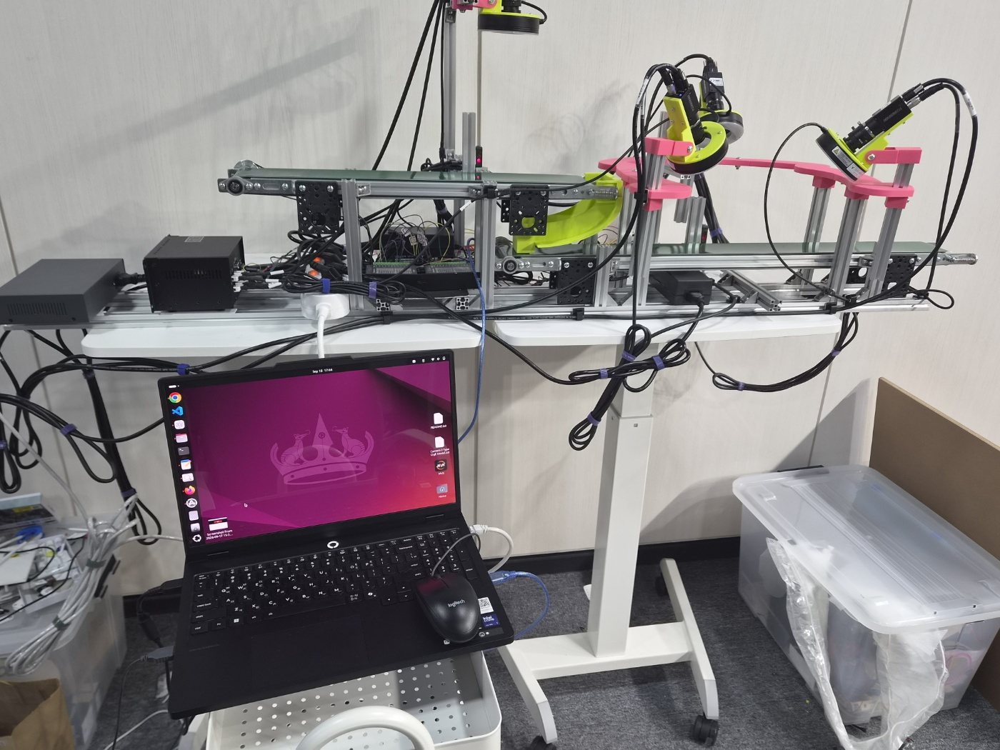

</div>

<br>

| **F1-score** | **Recall** | **Accuracy** | **Inference** | **Throughput** |
|:---:|:---:|:---:|:---:|:---:|
| **0.968** | **0.973** | **0.958** | **~122 ms / image** | **60 parts / min** |

<sub>Measured on a held-out test set of 148 good and 261 defective samples. See [Results](#results) for details.</sub>

---

## Demo

<a href="https://youtu.be/6IXVnJ5pf2U">
  
</a>

| Scene | Jump to |
|---|---|
| Photo sensor detects a part and triggers lights and cameras | [00:29](https://www.youtube.com/watch?v=6IXVnJ5pf2U&t=29s) |
| Automatic capture from the external trigger | [02:10](https://www.youtube.com/watch?v=6IXVnJ5pf2U&t=130s) |
| Live result display | [03:05](https://www.youtube.com/watch?v=6IXVnJ5pf2U&t=185s) |
| One-command continuous inspection | [03:26](https://www.youtube.com/watch?v=6IXVnJ5pf2U&t=206s) |
| Four images collected per part | [03:37](https://www.youtube.com/watch?v=6IXVnJ5pf2U&t=217s) |
| Results saved to JSON | [04:11](https://www.youtube.com/watch?v=6IXVnJ5pf2U&t=251s) |

---

## Overview

The industry partner inspected every part by eye, which was **labor-intensive** and gave **inconsistent results from one inspector to the next**. We built a low-cost automated inspection station designed to sit directly after the production line.

- **Four-channel capture:** One overhead camera images the top face. The part is then flipped 180°, and three cameras spaced 120° apart image the underside and thread, leaving no blind spots.
- **Capture without stopping:** A photo sensor sends a hardware trigger that fires a strobe light and the camera together, so parts are imaged sharply while the belt keeps moving.
- **Multi-label decisions:** A single part can have several defects at once, so the model outputs an independent sigmoid score per defect type, and each score is compared with its own threshold.
- **Part-level fusion:** The four per-camera results are merged (union of detected defects) into one final OK / NG record with defect types.
- **Decoupled processes:** Capture, inference and UI run as separate processes, so a delay in one stage never stalls the others.

## Defect types

| Good | Burr | Thread | Black spot | Shrinkage | Short shot |
|:---:|:---:|:---:|:---:|:---:|:---:|
| 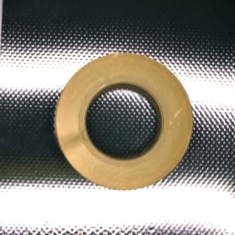 | 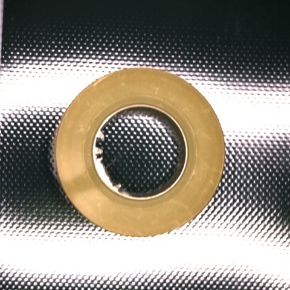 | 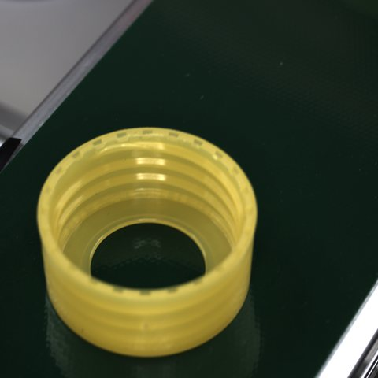 | 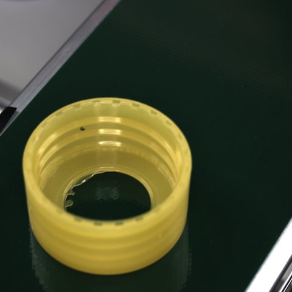 | 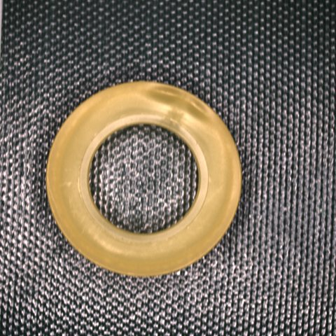 | 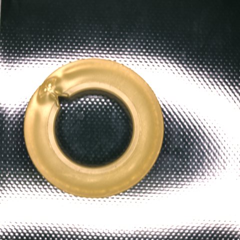 |
| No defect conditions met | Leftover flash on the inner rim makes the circle uneven | Thread molded longer or shorter than spec | Off-color specks on the surface | Top or side surface shrinks and becomes uneven | Shape is not continuous (incomplete molding) |
| — | `burr` | `thread_defect` | `contamination` | `shrinkage` | `incomplete_molding` |

## System

<p align="center">
  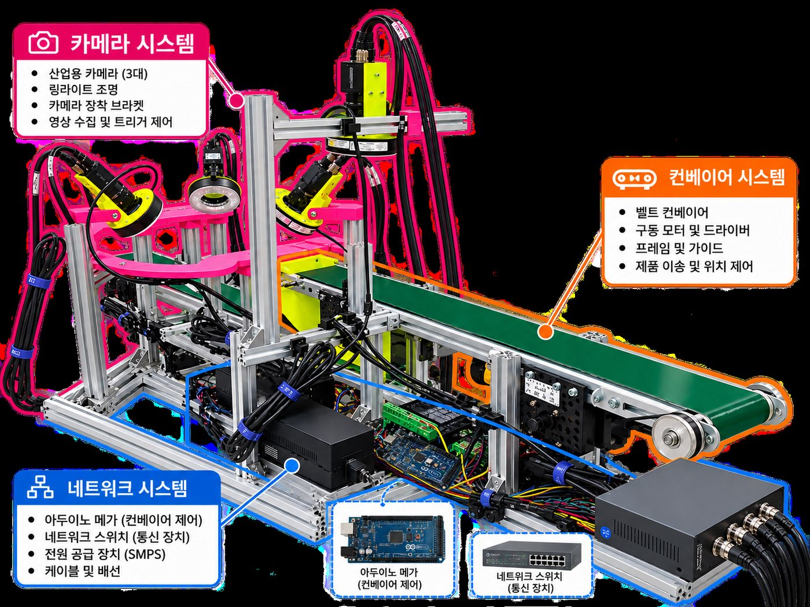
</p>

| Component | Model / spec | Qty | Role |
|---|---|:---:|---|
| Conveyor | Arduino-controlled conveyor belts (A1, A2) | 2 | Moves parts: top face → flip → underside |
| Photo sensor | Autonics BJ50-BDT | 2 | Detects translucent parts and hardware-triggers lights and cameras |
| Camera | Hikrobot MV-CS050-10GC (GigE) | 4 | Image capture |
| Lens | MVL-MF2518M-5MPE | 4 | High-resolution imaging |
| Lighting | LED ring light DRLF-90R50-D-SW | 4 | Lit only at the moment of capture (strobe) |
| Network | PoE switch NX-POE604GS | 1 | Power and data for all four cameras |
| Frame | 20×20 aluminum profile + 3D-printed mounts | — | Adjustable camera and light position / angle |

<details>
<summary><b>Camera layout</b></summary>
<br>
<p align="center">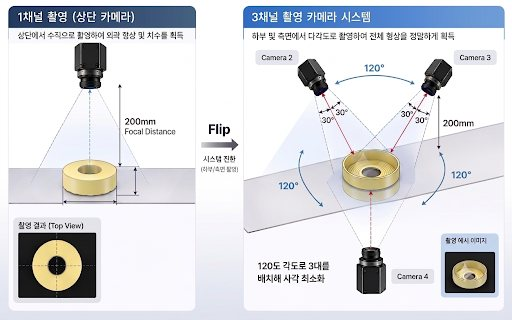</p>

| Channel | Inspected area | Mounting |
|---|---|---|
| Camera 1 | Top face | 20 cm directly above the part |
| Cameras 2–4 | Underside, side wall, thread | ~16 cm from center, tilted 30°, spaced 120° apart in a ring |

<p align="center">
  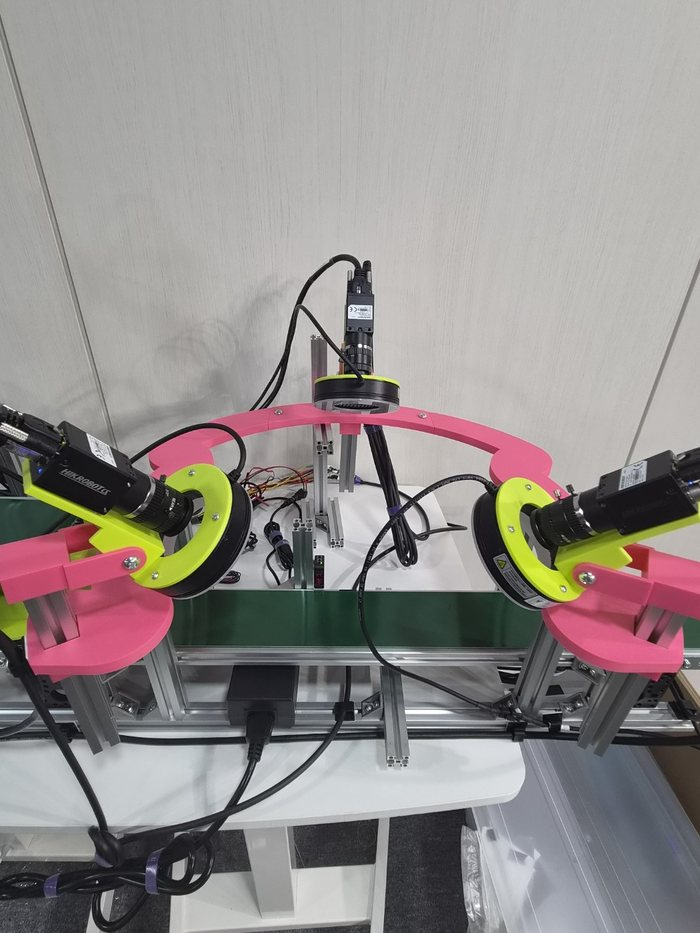
  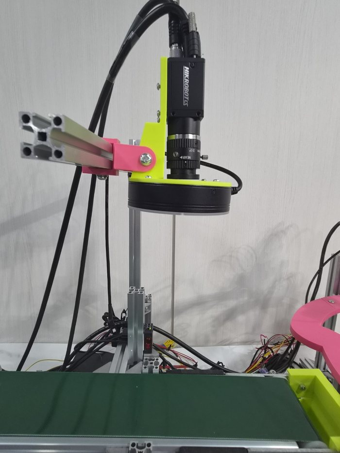
  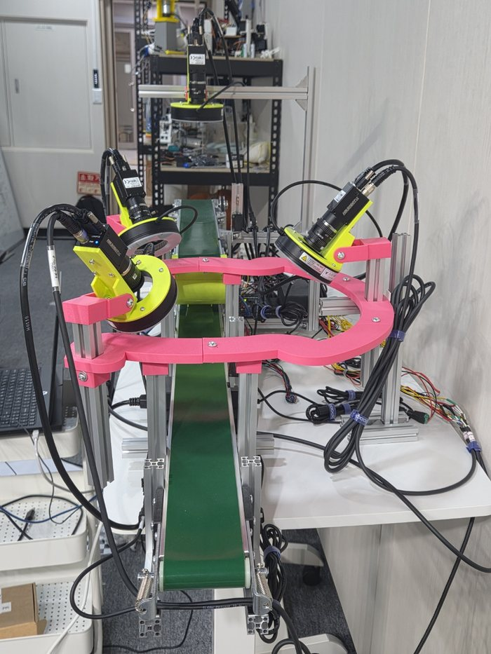
</p>
</details>

## Inspection pipeline

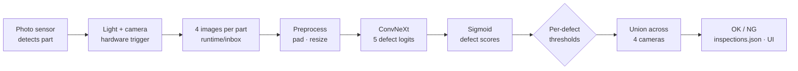

| Stage | Program | What it does |
|---|---|---|
| Capture | `scripts/save_4cam_png.py` | Saves four images per trigger as `object_####_camera_N.png` |
| Inference | `scripts/watch_folder.py` | Watches the inbox; once all four images arrive, scores them, writes the result to JSON and deletes the inputs |
| Display | `scripts/show_inspections.py` | Shows the latest verdict in large green (OK) / red (NG) text with a running history |

<p align="center">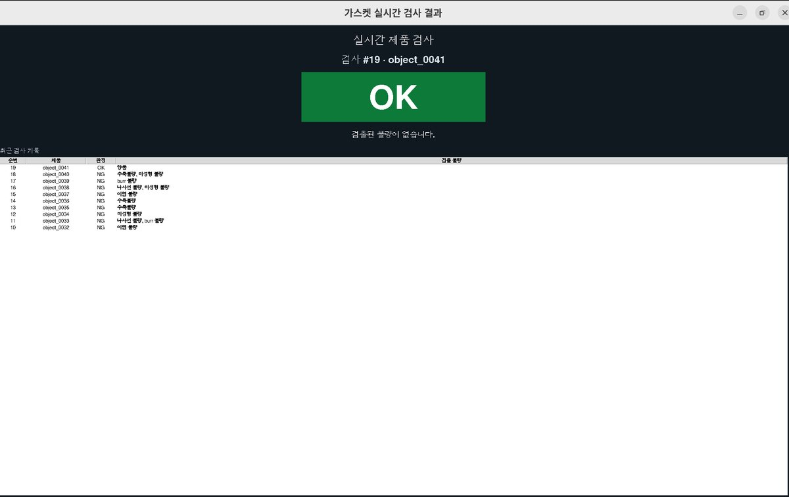</p>

## Model

- ImageNet-pretrained **ConvNeXt** backbone (`tiny` / `small` / `base`; default `convnext_small`) with a single head that outputs one independent logit per defect type
- `BCEWithLogitsLoss` with frequency-based `pos_weight` to compensate for rare defects
- 512 × 512 input (padded to square, then resized, so small burrs survive)
- Backbone frozen for the first 3 epochs, then fine-tuned at a lower learning rate, with early stopping on validation loss

**Why ConvNeXt?** Defects are small, local changes in edges, texture and color, which suits the local feature extraction of a CNN, and pretrained weights let it converge reliably on a small dataset. We also considered ViT, but judged it more prone to overfitting with limited data.

**Why binary labels?** Severity scores (e.g. 0–3) vary from one labeler to the next and make the labels noisy. We label only whether each defect is present (0/1) for consistency, and tune detection sensitivity with **thresholds** that are decoupled from training.

## Results

Data was split 70 / 20 / 10 into train / validation / test **by part (cycle) ID**, so the four views of one part never land in different splits.

| Metric | Overall | Shrinkage | Short shot | Burr | Black spot | Thread |
|---|:---:|:---:|:---:|:---:|:---:|:---:|
| Accuracy | **0.958** | 1.000 | 1.000 | 0.976 | 0.989 | 0.931 |
| Precision | **0.962** | 1.000 | 1.000 | 0.947 | 1.000 | 0.870 |
| Recall | **0.973** | 1.000 | 1.000 | 0.964 | 0.958 | 0.870 |
| F1-score | **0.968** | 1.000 | 1.000 | 0.956 | 0.979 | 0.870 |
| TP / FP / TN / FN | 254 / 10 / 138 / 7 | 51 / 0 / 148 / 0 | 52 / 0 / 148 / 0 | 54 / 3 / 145 / 2 | 46 / 0 / 148 / 2 | 47 / 7 / 141 / 7 |
| Threshold | — | 0.9468 | 0.9990 | 0.9794 | 0.9953 | 0.9900 |

- **Test conditions:** one part placed on the conveyor every second. Repeated runs on the same part set flipped **fewer than 1% of decisions**.
- **Endurance:** ran continuously for **5 hours, capturing ~3,000 images** during data collection, with no overheating or shutdowns.
- **Threshold selection:** we picked the threshold with the lowest overall error that did not increase false negatives (defective parts passed as good).

**Limitations and next steps**

- **Burr:** small burrs were sometimes lost in reflections at the rim. A matte black belt and adjusted lighting angles should raise contrast.
- **Thread:** good and defective threads differ only subtly, even to the eye, so both FP and FN were relatively high. Next steps are a clearer acceptance criterion and more borderline samples for retraining.
- Parts placed off-center on the belt can be partially cropped, so a centering guide is needed on the line.

## Getting started

```bash
python -m venv .venv && source .venv/bin/activate   # Windows: .\.venv\Scripts\Activate.ps1
pip install -r requirements.txt
```

**Train**

```bash
python scripts/validate_manifest.py --config configs/default.yaml   # check labels
python scripts/train.py --config configs/default.yaml               # writes runs/best.pt
```

**Run live inspection** in three terminals:

```bash
python scripts/save_4cam_png.py                                                          # 1. capture
python scripts/watch_folder.py --config configs/default.yaml --checkpoint runs/best.pt   # 2. inference
python scripts/show_inspections.py --config configs/default.yaml --fullscreen            # 3. result screen
```

> [!NOTE]
> The capture script requires the Hikrobot **MVS SDK** (`/opt/MVS`). Before running it, set the camera serials (`CAMERAS`) and output path (`SAVE_ROOT`) at the top of `scripts/save_4cam_png.py` for your setup.<br>
> Image data and trained checkpoints (`runs/`) are not included in this repository because of their size.

See **[docs/GUIDE.md](docs/GUIDE.md)** (Korean) for label format, threshold tuning, JSON schema and capture tips. The full project report (Korean) is in **[report/](report/)**.

## Structure

```
.
├── configs/default.yaml        # model, training, thresholds, realtime settings
├── data/labels.csv             # per-image 0/1 multi-label manifest
├── scripts/
│   ├── save_4cam_png.py        # photo-sensor-triggered 4-camera capture (Hikrobot MVS)
│   ├── train.py                # training
│   ├── predict.py              # score a single image
│   ├── watch_folder.py         # realtime folder watcher, part-level decision
│   ├── show_inspections.py     # result GUI
│   └── validate_manifest.py    # label checks
├── src/gasket_inspection/      # model, dataset, decision and realtime logic
├── tests/                      # pytest
├── docs/                       # detailed guide and README images
└── report/                     # final project report (Korean, .docx)
```

## Team 4DOF

| Name | Role | Main contributions |
|---|---|---|
| Jehyun Lee | Team lead · Hardware | Overall hardware integration and concept, camera MVS / SDK setup |
| Kangmin Noh | Design · Hardware | Camera and lighting rig design and fabrication, aluminum-profile frame design |
| Wonjeong Yoo | Software | Neural network design and implementation, led image collection and training |
| Yunsu Lee | Design · Software | Part-flipping slider design and fabrication, camera SDK setup, inspection UI |

Developed in the **AI-Robotics Volunteer Corps Follow-up In-depth Solution Development Program** (Aug 2026), mentored by Kyungtae Lee.
